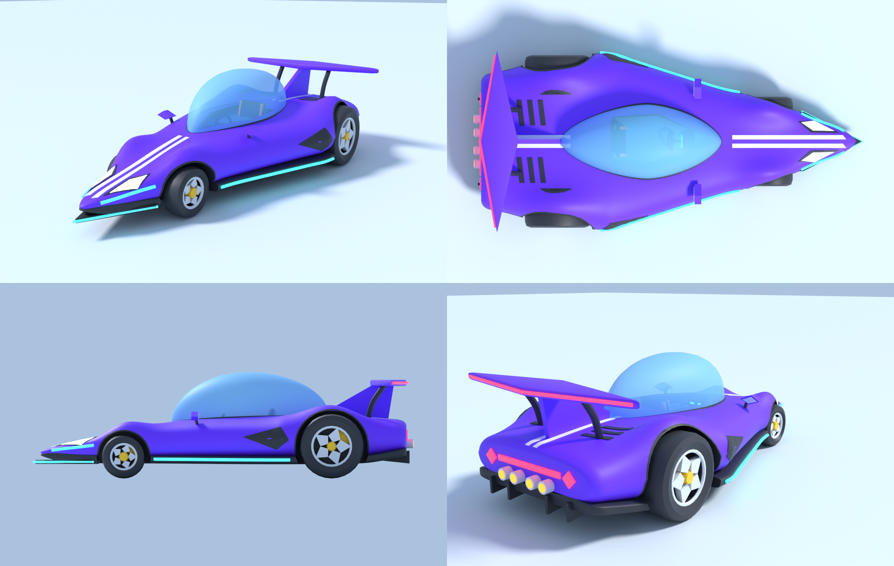

# Deltoid supercar (Blender, 2026-11-11, Claude)

A standalone cartoon supercar. **Seen from above it is a deltoid (kite)**: a long pointed nose, the widest point just in front of the rear wheels, and a short tapered tail. It has small front wheels on a narrow track, big rear wheels under raised hips, a bubble canopy with a centre seat, a kite-shaped rear wing on a dorsal fin, kite headlights, intakes and spokes, cyan neon trim and quad exhausts.

It has **not** been imported into Studio or uploaded, and it is not drivable yet (it has no VehicleSeat, constraints or physics).



## Files
- `deltoid.py`: the parametric builder (w2lib conventions: 1 unit = 1 stud, front = Blender −Y = Roblox −Z, origin = floor centre).
  - The palette and every dimension are constants at the top.
- `fbx/Deltoid.fbx`: the import file. It contains 29 parts plus the `Ref__Origin__FF00FFNE` origin marker.
- `blend/Deltoid.blend`: the Blender scene.
- `renders/`: hero, top, side and rear views, plus `Deltoid_sheet.png`.
- `stats_deltoid.json`: size, triangle counts per part and the part list.

## Numbers
- **Size:** 8.5 × 18.3 × 5.1 studs (width × length × height). The canopy top is at 5.0.
- **Triangles:** 33.1K in total. The largest part is Body at 8.8K, under the 9000-per-part budget.
- **Wheels:** front r 1.05 at y −5.0 (track ±1.6); rear r 1.55 at y +5.0 (track ±3.2).
- **Seat:** the seat cushion top is at Roblox local (0, 1.65, 1.15). The cockpit floor is at y 1.2.

## Parts
- Every name follows the pattern `Deltoid__<Part>__<RRGGBB><MAT>[Tnn]`.
- **Body and trim:** Body, Floor, WheelWell (dark arch liners), Cockpit (dark tub), Canopy (Glass, 35% transparent), Frame, Aero (wing, fin, mirrors), Trim, Stripe, Chrome.
- **Lights (Neon):** Lights (headlights), Neon (cyan), Tail (red), Exhaust (orange glow).
- **Interior:** Interior, SeatTrim.
- **Wheels:** each wheel is its own set, Tire/Rim/Hub + FL/FR/RL/RR, so it can spin. Caliper is one static part.
- **Left and right:** these names already follow the Roblox side. Blender −X is the car's right.

## Import into Studio (same route as the body / W1 packs)
1. Use the 3D Importer on `fbx/Deltoid.fbx`. Move the imported model to `ServerStorage.W1RemasterImports` and name it `Deltoid`.
2. In the command bar, run `require(game.ServerStorage.W1RemasterKit).postProcess("Deltoid")`.
3. The result is `ServerStorage.W1RemasterBuilt.Deltoid`:
   - colours, materials and transparency are applied from the part names;
   - parts are renamed to `<Part>`;
   - `Root` is at the origin and is the PrimaryPart;
   - everything is anchored, with no collision.

## Rebuild
Use the `bpy` 5.3 module (`pip install bpy`) or Blender 5.x:
```
python deltoid.py --export --save --render [--views=hero,top,side,rear] [--samples=64]
blender -b --factory-startup -P deltoid.py -- --export --save --render
```
- Renders use Cycles on the CPU.
- The script finds `../World2Blender/w2lib.py` by a relative path.
- Wheel arches and the cockpit are cut with EXACT booleans. Decals are projected onto the body with ray casts.
